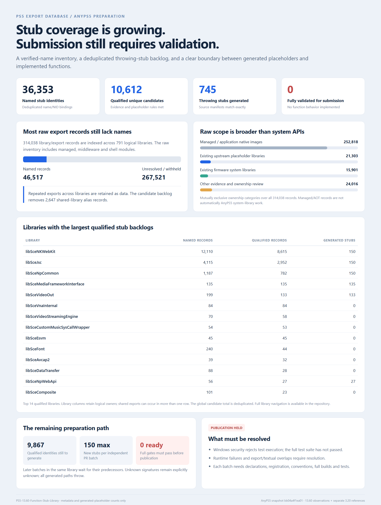

# PS5 13.60 Function Stub Library

A data-only inventory of exported function identities and verified name/NID bindings.
It contains no function implementations, C forwarding stubs, firmware, keys, SDK files,
disassembly, decompiled code, console data, or local research paths.

| Dataset | Export records |
|---|---:|
| Observed in the extraction labeled PS5 13.60 | 302,338 |
| Historical PS5 3.20 references without a matching local 13.60 export | 11,700 |
| Total distinct library/NID identities | 314,038 |
| Records with a recovered name | 47,017 |

## Start here

[Browse libraries](LIBRARIES.md) · [Stub readiness](READINESS.md) · [Readiness data](readiness.json)

## Files

- [Library index](data/library-index.csv): every logical library and its data file.
- [Verified name map](data/verified-name-map.jsonl): deduplicated NID/name bindings.
- [Manifest](manifest.json): row counts and SHA-256 digests for every data file.
- [Data dictionary](DATA_DICTIONARY.md): field definitions and status meanings.
- [Sources](SOURCES.md): public name references and provenance limits.
- [Privacy and scope](DATA_POLICY.md): excluded material and publication filters.
- [AnyPS5 use](ANYPS5.md): limits on stub generation and overlap handling.

The main inventory is under `data/firmware-13.60/`. Historical-only records are kept
separately under `data/historical-3.20-only/`; their presence does not establish a
13.60 export. Files are UTF-8 JSON Lines with one record per logical library/NID.

Names are verified by recomputing the NID with AnyPS5's algorithm. Names do not
establish parameter counts, return types, C++ object layouts, behavior, or compatibility.
Unknown names remain null. Managed/AOT, middleware, shell, and uncertain ownership
are explicitly classified and must not all be turned into AnyPS5 system-library stubs.
The firmware label is research provenance, not an independent hardware measurement.

## Stub readiness report

The image below was generated from an earlier readiness snapshot. See [readiness.json](readiness.json) and [READINESS.md](READINESS.md) for current naming totals.

## Separate recovery candidate index

A [sanitized review queue](data/recovery-candidates.jsonl) tracks **742** candidate
library/NID identities: **152 already recovered** in the ICU name update,
**588 remaining unresolved candidates**, and **2 publication-filtered** records.
The queue contains no proposed or withheld name strings. No additional names
or throwing-stub candidates become verified by merging this queue.
See the [candidate reconciliation](analysis/INTEGRATION-FINDINGS.md).
